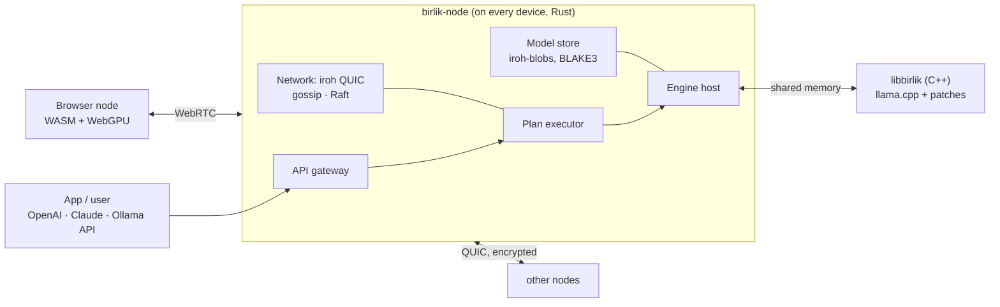
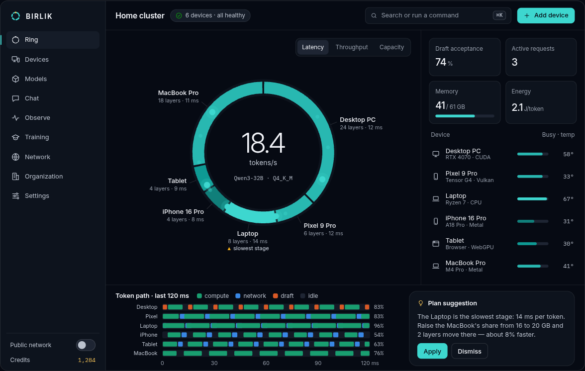

<div align="center">


# BIRLIK

**Every device is an arc. Together, one mind.**

BIRLIK turns computers, phones, servers and browsers into one AI cluster —<br>
from the devices in one home to idle devices around the world.

[](https://github.com/HumoyunDavronov2001/birlik/actions/workflows/ci.yml)
[](LICENSE)


[Plan](PLAN.md) · [Requirements](REQUIREMENTS.md) · [Design concept](design/concept.html) · [Protocol](protocol/README.md) · [Contributing](CONTRIBUTING.md)

</div>

> *Birlik* means **unity** in Uzbek.

## Why

Billions of devices sit idle most of the day. Together they hold more compute than any data center, yet today's
tools each cover only one corner of it:

| | exo | prima.cpp | GPUStack | **BIRLIK** (goal) |
|---|:-:|:-:|:-:|:-:|
| Phones: Android, iOS | — | Termux only | — | native apps |
| Browsers: join with a QR code, no install | — | — | — | ✓ |
| Windows · Linux · macOS | macOS | Linux, macOS | Linux | ✓ |
| CUDA · ROCm/Vulkan · Metal · OpenCL · NPU | Metal | CUDA | server GPUs | ✓ |
| Devices join and leave at runtime | ✓ | — | ✓ | ✓ |
| Across the internet, behind NAT | — | — | — | ✓ |
| Inference **and** training | — | — | — | ✓ |

The BIRLIK column lists goals of the [roadmap](#roadmap), not shipped features.

## How it works

- **Every device is an arc on the ring.** A model's layers are split across devices in proportion to their measured
  power, and a token travels around the ring through each of them.
- **More devices make a single answer faster, too.** A continuous pipeline with speculative decoding keeps every
  device busy at the same time instead of waiting for its turn.
- **Only what is active is computed.** MoE experts and hot/cold neurons are spread across devices, so
  trillion-parameter models fit on ordinary hardware.
- **Nothing stops when a device leaves.** Layer replicas and continuously copied KV caches take over within a second.
- **Any device, any link.** Native apps on five platforms plus a WebGPU browser node; QUIC with NAT traversal over
  Wi-Fi, Ethernet, USB-C and Thunderbolt.
- **Private by default.** All traffic is encrypted. On the public network raw text never leaves your device, and every
  answer carries a TOPLOC proof.



## Design

<picture>
  <source media="(prefers-color-scheme: light)" srcset="design/assets/home-screen-light.png">
  
</picture>

The interface shows the mechanism itself: an arc's length is the device's share of layers, its color is the load,
and tokens move at the measured speed — so a slow device or a slow link stands out at a glance.

- Colors come from Samarkand's tilework — lapis, turquoise, gold and ganch plaster — with a single accent.
- One token source ([`design/colors.py`](design/colors.py)) generates CSS, Swift, Kotlin and TypeScript; every text
  color passes WCAG AA and every chart color passes color-vision checks.
- The living ring ([`design/living-ring.js`](design/living-ring.js), WebGL2, no dependencies) is the brand mark:
  ~15,000 GPU particles, one comet per token in flight.

See the full [design concept](design/concept.html) (download it and open it in a browser) and the
[living ring video](design/living-ring.mp4).

## Status

**Pre-alpha.** Stage B0 (foundation) is complete; stage B1 (engine) is next. Nothing runs as a cluster yet.
Stage B0 delivered:

- [`protocol/`](protocol) — `birlik.v1` messages and the tensor frame spec, with a Rust implementation and property tests.
- [`node/`](node) — the Rust workspace; `birlik-node info` describes a device the way it will announce itself.
- [`engine/`](engine) — the engine's C ABI, tested from plain C.
- [`design/`](design) — design tokens for every platform with a contrast gate, the living ring, the design concept.
- [`web/`](web) — the Svelte 5 component library in Storybook, with visual-regression and axe (WCAG 2.2 AA) checks.
- CI on Linux, Windows, macOS, Android, iOS and the web.

## Roadmap

| Stage | Scope | Gate |
|---|---|---|
| **B0 Foundation** ✓ done | monorepo, CI, protocol v1, design system | CI green on 6 platforms; visual and accessibility checks |
| **B1 Engine** ← next | llama.cpp + prima.cpp piped-ring, Windows, Vulkan | a 70B model across Linux and Windows machines |
| B2 Network | iroh P2P, QR pairing, peer-to-peer model distribution | two networks behind NAT form one cluster |
| B3 Scheduler | placement, live join and leave, replicas | recovery within 1 s |
| B4 Speed | pipelined speculation, MoE, sparse FFN | single-request speed grows with the device count |
| B5 Devices | desktop, Android, iOS, browser, NPU | six node types; joining from a browser in 30 s |
| B6 Scale | organizations, public network, credits | 1,000+ nodes |
| B7 Modalities and training | speech, images, LoRA, RL | distributed LoRA over the internet |
| B8 Islands and API | MLX, vLLM/SGLang, OpenAI/Claude/Ollama APIs | throughput on par with vLLM on NVIDIA |
| B9 World benchmark | open benchmarks against exo, prima.cpp, Parallax and others | v1.0 |

Details: [PLAN.md](PLAN.md) and [REQUIREMENTS.md](REQUIREMENTS.md).

## Build

```bash
# Protocol and node agent (Rust)
cargo test --workspace
cargo run -p birlik-node -- info

# Engine (C++20 with a C ABI)
cmake -S engine -B build/engine && cmake --build build/engine && ctest --test-dir build/engine

# Design tokens and the concept page
python3 design/colors.py && python3 design/build.py

# Component library (inside web/)
pnpm install && pnpm check && pnpm test && pnpm build-storybook && pnpm test:visual
```

With [just](https://github.com/casey/just) installed, `just check` runs all of it.

## Repository

```
protocol/   Protobuf messages (birlik.v1) and the tensor frame spec
node/       Rust workspace: birlik-protocol, birlik-node
engine/     libbirlik — C++20 engine with a C ABI
design/     design tokens, the living ring, the design concept
web/        Svelte 5 component library (Storybook)
docs/uz/    Uzbek reading copy of the plan
```

## Credits

BIRLIK builds on [llama.cpp](https://github.com/ggml-org/llama.cpp), [prima.cpp](https://github.com/OpenCPIL/prima.cpp),
[exo](https://github.com/exo-explore/exo), [GPUStack](https://github.com/gpustack/gpustack) and other open-source work —
see [UPSTREAM.md](UPSTREAM.md) and [NOTICE](NOTICE).

## License

[Apache License 2.0](LICENSE)
